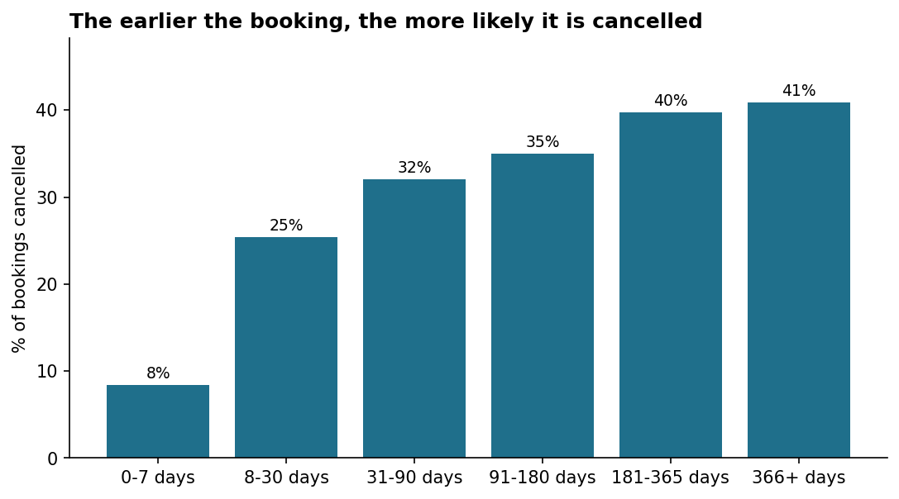
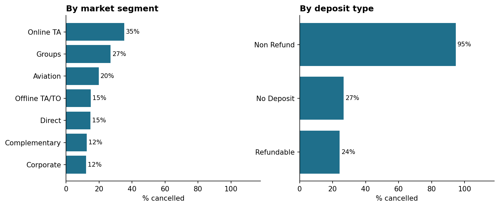
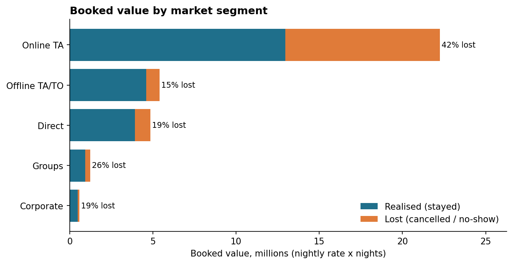
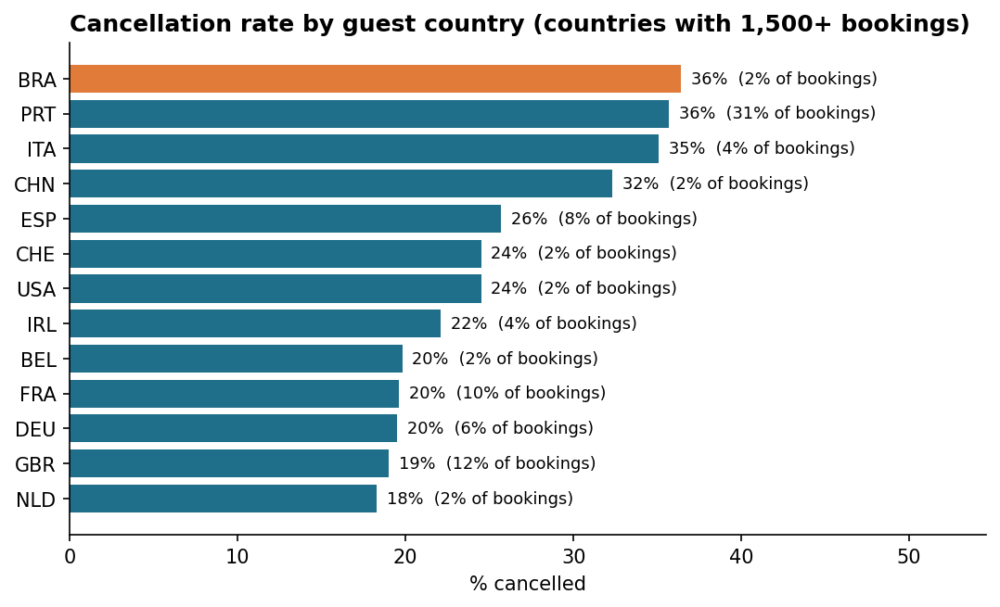
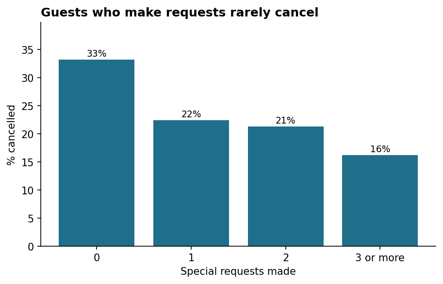
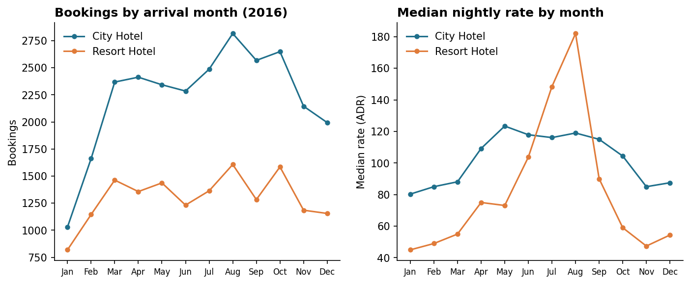

# Hotel Bookings: Data Cleaning, Validation & Cancellation Analysis in SQL

Cleaning, validating and analysing **119,390 hotel bookings** (a city hotel and a resort hotel, arrivals July 2015 to August 2017) using SQL. The analysis focuses on what drives cancellations and where booked revenue is lost.

**Tools:** SQL (SQLite dialect), Python (loader and charts only)

**Data:** the public *Hotel booking demand* dataset (Antonio, Almeida & Nunes, *Data in Brief*, 2019). Check its licence before redistributing the raw file, which is why it is not committed here.

## The problem

The data has no obvious blanks, which hides the real problems:

| Issue | What I found |
|---|---|
| **Missing values stored as text** | The tokens `NULL` and `NA` instead of empty cells: `company` 112,593 (94.3%), `agent` 16,340 (13.7%), `country` 488, `children` 4 |
| **Exact duplicate rows** | 31,994 rows (26.8%) are identical to an earlier row in all 32 columns, and there is no booking ID to tell real repeats from copies |
| **Undefined codes** | `meal = Undefined` (1,169 rows), `market_segment = Undefined` (2), `distribution_channel = Undefined` (5) |
| **Inconsistent country codes** | 1,279 rows use `CN`; every other country uses a 3-letter ISO code |
| **Impossible values** | 180 bookings with zero guests, 715 with zero nights, 1,959 with a rate of exactly 0, 1 negative rate, 1 rate of 5,400 against a median of about 95, 12 bookings with more than 10 adults |
| **Contradictory fields** | 6,827 rows where `is_repeated_guest` disagrees with the guest's own booking history, and 27 check-outs that do not match arrival plus nights |
| **Dates split across columns** | Arrival is a year, a month *name* and a day in three columns |
| **Outcome fields mixed with predictors** | `reservation_status`, its date, parking spaces and room changes are only known after booking or at arrival |

## Cleaning approach

`raw_bookings` is loaded with every column as text and is never modified. A typed stage, a duplicate stage and the final `bookings_clean` table are built from it. **No row is deleted:** problems are fixed where safe and flagged where not.

| Step | Issue | Method |
|---|---|---|
| Types | Everything is text | Cast to integers and reals; `NULL` / `NA` tokens become real NULLs; month names mapped through a reference table |
| Dates | Split columns | Build and validate an ISO `arrival_date`; derive `booking_date` (arrival minus lead time) and `arrival_weekday` |
| Missing | `country`, `children` | Country becomes `Unknown` (488); children set to 0 and flagged (`children_imputed`, 4 rows) |
| Agent / company | `NULL` means none | Kept as `has_agent` / `has_company` flags. A missing agent is a direct booking, not missing data |
| Codes | `Undefined`, `CN` | `Undefined` meal merged into "No meal package" (as the dataset describes); other `Undefined` becomes "Not specified"; `CN` becomes `CHN` |
| Plausibility | Impossible values | Flag zero guests, zero nights, rate <= 0, rate > 1,000, extreme parties. `is_valid_stay` is 1 only when none apply |
| Consistency | Contradictions | Flag repeat-guest contradictions and check-out date mismatches. Not changed |
| Derived | Analysis measures | `total_nights`, `total_guests`, `party_type`, `lead_time_bucket`, `room_changed`, `booking_value` (rate x nights, valid stays only) |
| Duplicates | Identical rows | Flag with `ROW_NUMBER()` over all 32 original columns; analysis uses the `bookings_unique` view |

### Decisions worth calling out

- **Duplicates are flagged, not deleted, and the choice matters.** Without a booking ID I cannot prove these rows are copies rather than genuine repeat bookings. I excluded them from analysis so they would not be double-counted, and checked whether it changes the conclusions (see below).
- **Duplicates are not random.** The 31,994 repeated rows are cancelled 63.1% of the time against 27.5% for first occurrences, and 42.3% of them are non-refundable against 1.2%. Keeping them would raise the headline cancellation rate from 27.5% to 37.0%.
- **A zero rate is not an error by default.** 680 of the zero-rate rows are complimentary stays. All are excluded from rate and revenue analysis through `is_valid_stay`, but kept in the data.
- **Cancelled bookings have a quoted rate, not a paid one.** "Lost value" below is the rate x nights that would have been booked, an upper bound on lost revenue.

## Validation

`sql/03_validate.sql` runs **26 checks**, each comparing an expected value with an actual one. The pipeline stops if any fail. Examples:

- 119,390 rows in and out, every `row_id` present, no key column null
- `reservation_status` agrees with `is_canceled` in every row
- every arrival date is a valid ISO date inside the expected window, no booking date falls after arrival, no cancellation is dated after arrival
- `total_nights` and `total_guests` equal the sum of their parts
- countries are 3-letter codes or `Unknown`, and every category is in its allowed set
- missing agents, countries and children match the raw counts, and the zero-guest flag matches an independent recount
- duplicate flags equal an independent `COUNT(*) - COUNT(DISTINCT ...)` calculation

All 26 pass. I also cross-checked the unique-row count (87,396), the lead-time cancellation rates and the valid-stay count (85,582) against an independent pandas calculation, with exact agreement.

## Key findings

Cancellation figures use the **87,396 distinct bookings**. Rate and revenue figures use the 85,582 valid stays.

### 1. More than a quarter of bookings are cancelled, and early bookings are the riskiest

27.5% of distinct bookings are cancelled (37.0% in the raw file, because of the duplicates). The City Hotel cancels 30.0% against 23.5% at the Resort Hotel.



Cancellation climbs from 8.4% for bookings made in the final week to 39.7% at 181 to 365 days and 40.9% beyond that.

### 2. Online travel agents drive the problem



Online TA is 59.1% of bookings and cancels 35.3% of them, against 14.9% for Offline TA/TO, 14.7% for Direct and 12.1% for Corporate. Online TA accounts for about **81% of all lost booked value** (9.3 of 11.5 million), and 41.7% of its own booked value is lost.

Non-refundable bookings are cancelled 94.7% of the time (1,038 bookings), which is the opposite of what a deposit should do. I have not worked out why, so I would not read it as a deposit effect.

### 3. Roughly a third of booked value never turns into a stay



Of 34.4 million booked (rate x nights), 11.5 million (33%) was cancelled or no-show: 35.2% at the City Hotel and 31.0% at the Resort Hotel.

### 4. Guest country and booking history predict cancellation



Portuguese guests are 31.4% of bookings and cancel 35.7% of the time. Brazil (36.4%), Italy (35.1%) and China (32.3%) are similar, while the UK (19.0%), France (19.6%), Germany (19.5%) and the Netherlands (18.3%) are much lower. Repeat guests are only 3.9% of bookings but cancel 7.6% against 28.3% for new guests, and guests with a previous cancellation cancel 67.9% of the time.



Guests who make no special request cancel 33.2% of the time, falling to 16.2% for three or more.

**A trap to avoid:** parking spaces (0.0% cancelled among 7,313 bookings that requested one), room changes (4.7%) and booking changes (15.5%) look like strong signals, but they are recorded after booking or at arrival. They describe guests who showed up, so they cannot predict cancellation. They are excluded from the conclusions above.

### 5. Seasonality is a pricing story at the resort



The Resort Hotel's median nightly rate rises from 45 in January to 182 in August (four times higher), while its bookings move far less. The City Hotel is steadier, ranging from 80 in January to 123 in May. Both hotels are quietest in January.

### 6. Growth slowed in 2017

Compared with the same month a year earlier, bookings were up 53.8% in January 2017 and 17.3% in February, flat or slightly down in March (-3.9%) and August (-0.9%), and up 10% to 21% in between. Cancellation also rose, from 28.3% in July 2016 to 36.7% in August 2017. The first year starts in July 2015, so the large 2016 increases partly reflect coverage.

### 7. Who stays, and for how long

Couples are 64.7% of bookings, solo travellers 18.4% and families 10.4%. Median nightly rates are 94 for couples, 75 for solo travellers, 145 for families and 150 for groups of three or more adults. Resort stays average 4.27 nights against 3.02 in the City Hotel, and 26.3% of resort stays last a week or longer against 4.6%. One travel agent supplies 38.2% of all agent bookings, the top three 60.0% and the top ten 77.2%.

### Do the conclusions depend on removing duplicates?

Some conclusions are stable and some are not. Lead time still rises steadily and the City Hotel still cancels more than the Resort Hotel. The segment picture is less stable: with duplicates, Groups (61.1%) overtake Online TA (36.7%) and Offline TA/TO jumps from 14.9% to 34.3%, nearly matching Online TA. The size of the effects also changes a lot, for example 366+ day bookings cancel 67.7% with duplicates against 40.9% without. Anyone who can tell whether the repeated rows are real should settle this before quoting a number, and the Online TA findings above are stated for distinct bookings only.

## Limitations

- **No booking ID.** Duplicates cannot be confirmed, and the 26.8% affected materially changes the absolute cancellation rate.
- **Quoted rates, not paid ones.** Lost value is a ceiling on lost revenue, and there are no costs or actual payments.
- **Short window.** Arrivals run from July 2015 to August 2017, so 2015 is a half year and seasonality rests on one full year (2016).
- **Leakage-prone columns.** Several fields are only known after booking. They are kept for transparency but should not be used to predict cancellation.
- **Two properties only.** Results describe this dataset, not the hotel industry.
- **The deposit pattern is unexplained.** Non-refundable bookings cancelling at 94.7% needs more context than the data gives.

## Data dictionary (`data/cleaned/hotel_bookings_clean.csv.gz`)

| Column | Description |
|---|---|
| row_id | Position in the raw file (the data has no booking ID) |
| hotel, is_canceled, reservation_status | Property, cancelled flag and final status (Check-Out, Canceled, No-Show) |
| arrival_date, arrival_year, arrival_month, arrival_weekday | Validated ISO arrival date and parts (weekday 0 = Sunday) |
| booking_date, lead_time, lead_time_bucket | Derived booking date, days booked in advance, and a 6-band bucket |
| total_nights, total_guests, party_type | Weekend plus week nights; adults plus children plus babies; Solo, Couple, Family or Group |
| children_imputed, country_missing | 1 where children was set to 0 or country set to Unknown |
| meal_plan, country, market_segment, distribution_channel | Standardised categories (3-letter country codes) |
| has_agent, has_company, agent_id, company_id | Whether an agent or company was involved, and the anonymised IDs |
| room_changed, booking_changes, deposit_type, customer_type | As recorded or derived |
| adr | Average daily rate (quoted) |
| flag_* | Plausibility and consistency flags (zero guests, zero nights, rate <= 0, rate > 1,000, extreme party, repeat-guest contradiction, check-out mismatch) |
| is_valid_stay | 1 when no plausibility flag applies |
| booking_value | adr x total_nights, valid stays only |
| is_duplicate | 1 if an earlier row is identical in all 32 original columns |

## SQL techniques used

Layered stage tables, `CASE` classification, reference-table mapping, window functions (`ROW_NUMBER`, `COUNT OVER`, running totals) for de-duplication, **medians** and agent concentration, self-joins for year-on-year comparison, date functions (`DATE`, `STRFTIME`, date arithmetic), views, and a PASS/FAIL validation table.

## Repository structure

```
.
├── sql/
│   ├── 01_audit.sql       Profile the raw data
│   ├── 02_clean.sql       Typed stage, duplicate stage, bookings_clean, views
│   ├── 03_validate.sql    26 PASS/FAIL checks
│   └── 04_eda.sql         Analysis queries
├── run_pipeline.py        Loads the CSV, runs the SQL, saves results and charts
├── data/cleaned/hotel_bookings_clean.csv.gz
├── results/               Every named query result as CSV
├── images/
├── requirements.txt
└── README.md
```

## Run it yourself

1. Save the dataset as `data/raw/hotel_bookings.csv`.
2. Install the requirements and run the pipeline:

```bash
pip install -r requirements.txt
python run_pipeline.py
```

This rebuilds the database, runs all four SQL files, stops if any validation check fails, and regenerates `results/`, the cleaned file and the charts. Read the cleaned file directly with `pandas.read_csv("data/cleaned/hotel_bookings_clean.csv.gz")`.

**Dialect note:** the SQL targets SQLite, which comes with Python. To port to PostgreSQL or MySQL, replace `PRINTF` with `TO_CHAR`/`FORMAT`, `STRFTIME` with `EXTRACT`/`DATE_FORMAT`, and load the CSV with `COPY` or `LOAD DATA`.
